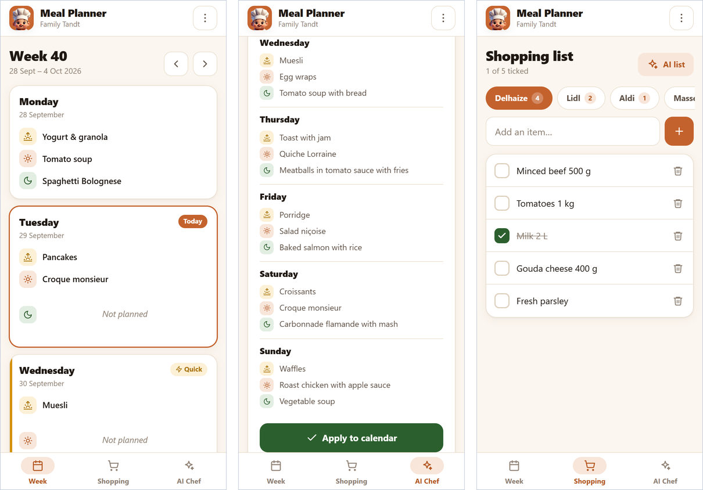

<h1 align="center">Meal Planner</h1>

A family meal planner with an AI chef: plan the week, keep a shopping list per store, and turn a photo of a dish into a shopping list.

## Why I built this

Every week, the same question comes back in our kitchen: *what are we going to eat next week?*

I wanted an app that helps with exactly that. It should suggest a week of meals, keep in mind which days are busy, and make the shopping list for us. And when I see a dish I like, I want to take a picture and have the AI tell me what it is, what I need to make it, and put those ingredients on the shopping list.

I looked online and did not find anything that worked the way I wanted. So last year I made it myself, for our family. This is the result.

— Hans Tandt

## What it does

- **Week planner**: breakfast, lunch and dinner for every day, with notes and photos.
- **Quick days**: mark busy days; the AI chef then suggests meals that are ready in 20 minutes or less.
- **AI chef**: suggests a full week of meals in one tap, and asks before it replaces meals you already planned.
- **Photo to shopping list**: photograph a dish, the AI names it, and one more tap puts its ingredients on the shopping list.
- **Shopping list per store**: Delhaize, Lidl, Aldi, Massen and Other, with an AI list built from the week's meals.
- **Four languages**: English, French, Dutch and German, including the AI's answers.
- **Phone and tablet**: bottom tabs on a phone, a side rail and wider grid on a tablet; light and dark mode.
- **Installable**: add it to the home screen and it opens full screen, like an app.
- **Backup**: export everything (photos included) to one file, and import it on another phone.

## How it works

The whole app is the [`app`](app) folder: one `index.html` with all HTML, CSS and JavaScript, plus images and icons. There is no build step, no framework and no library to install.

- **Data stays on the phone.** Meals and lists are stored in the browser (`localStorage`), photos in the browser's IndexedDB. Nothing is sent to a server, except the requests to the AI.
- **AI**: choose **Claude** ([Anthropic](https://platform.claude.com/settings/keys)), **ChatGPT** ([OpenAI](https://platform.openai.com/api-keys)) or **Grok** ([xAI](https://console.x.ai)) in the menu and paste your own API key. The app calls that service directly from the browser and asks for a fixed JSON answer format. Keys are stored on the device only and are never included in backups.
- **Lock**: on a new phone you choose a 4-digit PIN. It keeps the app private on a shared phone. It is a simple lock, not encryption.

## Get started

1. Put the `app` folder online. A free [Netlify](https://www.netlify.com) account works well: drag the folder onto your project's **Deploys** page.
2. Open the web address on your phone (Brave or Chrome) and choose a PIN.
3. Open the menu ⋮, choose Claude, ChatGPT or Grok, and paste that service's API key. AI requests are billed to that account.
4. Use the browser menu to install the app on the home screen.

The user manual explains every step with screenshots, also for people who are not technical: putting the app online with Netlify (Appendix B) and getting an API key for Claude, ChatGPT or Grok (Appendix C).
[English](manual/out/Meal_Planner_Manual_EN.pdf) · [Français](manual/out/Meal_Planner_Manual_FR.pdf) · [Nederlands](manual/out/Meal_Planner_Manual_NL.pdf) · [Deutsch](manual/out/Meal_Planner_Manual_DE.pdf)

The app is also offered as a download on [hanstandt.be](https://hanstandt.be/projects/meal-planner/).

## Where is the source code?

The folder [`app`](app) is the whole program. Its source code is one file, [`app/index.html`](app/index.html): the screens (HTML), the look (CSS) and the program (JavaScript) are all in it. You can open it with any text editor to read it. There is nothing to compile or install.

## Make it yours

The app was made for one family in the Belgian Ardennes, and it shows. To fit your own household, edit `app/index.html`:

- `STORES` and `STORE_NAMES`: the shops and their order.
- `storeRules()`: which kind of item goes to which shop.
- The prompts in `aiShop()`, `addIngredients()` and `planWeek()`: family size, region and cooking style.
- `I18N`: every text in the four languages.

## Coming next

- Learn from the meals you log and suggest what your family likes.
- Automatic sync between phones (today: export and import a backup file).
- Leftover ideas: cook once, eat twice.
- Photograph the fridge and get meals from what is inside.
- Shops and region chosen in the menu instead of in the code.
- Offline mode.

## Repository

| Folder | Contents |
|---|---|
| [`app`](app) | The app: deploy this folder |
| [`manual`](manual) | The user manuals in English, French, Dutch and German: `content_build.py` (one structure, four languages), the screenshot and figure scripts, and the finished PDF and Word files |
| [`Showcase`](Showcase) | Five screens per language, for a gallery |
| [`assets/mascot`](assets/mascot) | The chef mascot: source images, web versions and the prompts used to create them |
| [`docs`](docs) | Pictures for this page |

## Credits

- Idea, design, specification and testing: **Hans Tandt**.
- Code: written by **Claude** (Anthropic), from Hans's specifications.
- Chef mascot: generated with Grok Image; prompts in [`assets/mascot/PROMPTS.md`](assets/mascot/PROMPTS.md).
- Icons: shapes adapted from [Lucide](https://lucide.dev); see [THIRD_PARTY_NOTICES.md](THIRD_PARTY_NOTICES.md).

## Licence

[MIT](LICENSE) © 2026 Hans Tandt
